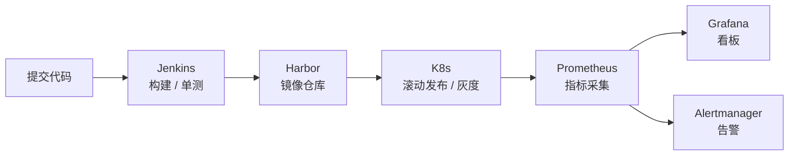

<h1>运维工程师 / SRE</h1>

Linux 出身，做 Kubernetes 集群运维、监控告警和 CI/CD 交付。 
习惯把巡检、变更、发布、排障的每一步写成文档，再想办法自动化掉。

 

  

---

## 关于

从 Linux 系统管理起手，现在主要做容器化平台的日常运维：

- **集群**：K8s 节点维护、工作负载发布与回滚、存储和网络排查
- **观测**：Prometheus 抓取配置、Grafana 看板、Alertmanager 告警收敛
- **交付**：Jenkins 流水线、Harbor 镜像管理、Ansible 批量作业

排障最怕两件事：日志找不到，指标口径说不清。所以项目里尽量把这两块先写明白。

## 一条完整的交付链路

从提交到可观测，每一段在下面的仓库里都能找到对应的脚本或清单。

## 仓库导航

| 仓库 | 是什么 | 先看这个 |
|:--|---|---|
| **[Ruoyi-cloud-cicd](https://github.com/Diaorongsong2/Ruoyi-cloud-cicd)** Jenkins · Harbor · K8s | RuoYi-Cloud 微服务从代码到 K8s 的整条交付记录，含灰度发布 | `Jenkinsfile`、`scripts/` |
| **[Dify-AI-SOP](https://github.com/Diaorongsong2/Dify-AI-SOP)** Helm · StatefulSet · 备份恢复 | Dify 大模型平台的私有化部署，依赖组件怎么排、数据怎么备 | 部署清单 |
| **[gpu-monitor](https://github.com/Diaorongsong2/gpu-monitor)** DCGM · Prometheus · Grafana | GPU 监控。显卡在 Windows 宿主、Prometheus 在 K8s 集群，跨机器抓取 | 指标口径说明 |
| **[Aliyun-tea-ecommerce-SOP](https://github.com/Diaorongsong2/Aliyun-tea-ecommerce-SOP)** ECS · ACK · SLB | 阿里云茶叶电商系统，ECS 自建中间件到 ACK 容器化的迁移 | 部署顺序图 |

## 踩过的坑

下面几条都是当时卡了不短时间的，怎么试错、最后怎么绕过去的，仓库里的 SOP 都记着。

**ACK 拉不动自建 Harbor 的镜像**

Harbor 用的是自签证书，节点上的信任也加了，照样 `ErrImagePull`。没在证书上继续折腾，最后在跳板机 `docker save` 出来，`ctr -n k8s.io images import` 直接导进节点。

**显卡在 Windows 上，Prometheus 在 K8s 里**

跨机器抓 `192.168.44.1:9400`。一开始去改 Operator 生成的 Secret，过几分钟就被 reconcile 改回去了，查了半天才发现改错了地方。后来走 `spec.additionalScrapeConfigs` 指向自己的 Secret，才稳住。

**后台上传大图报 413**

不是改一处就好。nginx 的 `client_max_body_size`、Spring 的 `max-file-size`、还有 SLB 带宽，三处得对得上，漏一个照样传不上去。

## 技术栈

**系统与容器**

    

**交付与监控**

     

**数据与云**

   

## 最近在做的

- 把运维里的重复动作交给智能体：Dify 工作流加 MCP 接口，试着让巡检和排障少一点手工
- GPU 算力环境的可观测性：DCGM 指标怎么落到看板，告警阈值到底该定多少

---

把每次排障都写成文档，下次就不用再猜一遍

